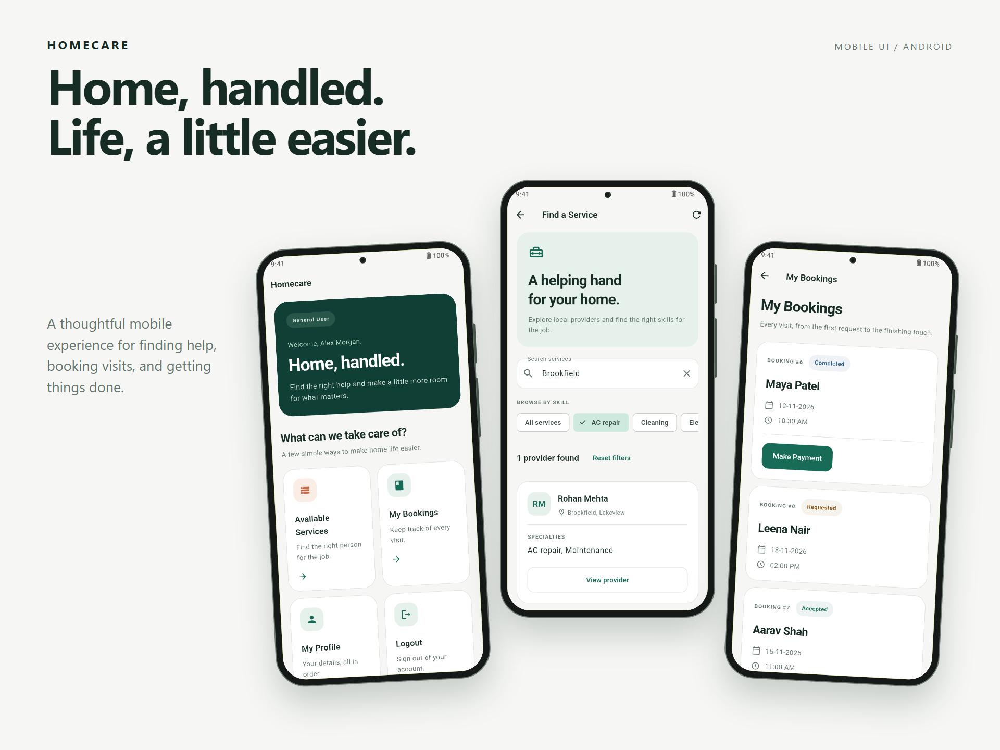
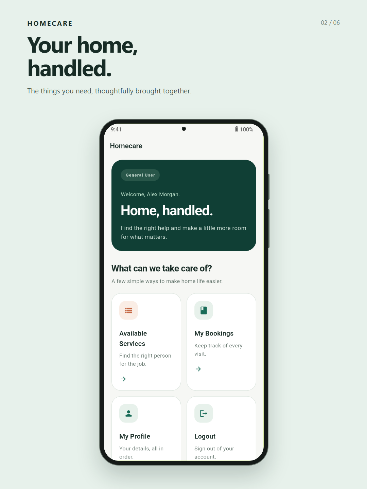
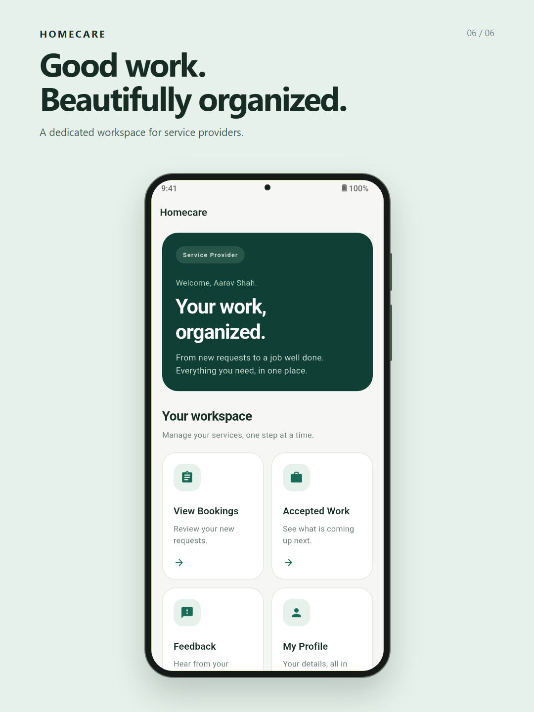

# 🏠 Home Care App

The **Home Care App** connects users with local home service professionals.
Whether you need a plumber, electrician, carpenter, or technician, you can browse providers, book a visit, and manage your home services in one place.

---

## 🚀 Features

### For Users

- 📅 **Book service slots** easily
- ⭐ **Rate and give feedback** to providers
- 🧾 **View booking history** anytime

### For Service Providers

- ✅ **Register and manage a profile**
- 📥 **Receive and manage booking requests**
- ⭐ **Review customer ratings and feedback**

---

## 🛠️ Tech Stack

- **Frontend:** Flutter
- **Backend:** PHP (XAMPP)
- **Database:** MySQL

---

## 📸 Screenshots



### Dashboards

| Customer dashboard | Service provider dashboard |
| --- | --- |
|  |  |

Screenshots use fictional demo data.

---

## 🗂️ Project Structure

```
lib/
├── constants/          # Shared colors and app theme
├── extensions/         # BuildContext, DateTime, and String extensions
├── models/             # User, ServiceProvider, Bookings, and FeedbackModel
├── ser_provider/       # Screens for service providers
├── services/           # Backend API configuration
├── user/               # Screens for users
├── utils/              # Shared form validators
├── widgets/            # Reusable UI components
├── ip_address.dart     # Backend connection setup
├── main.dart           # App entry point
├── select_user.dart    # User role selection
└── splash_screen.dart  # App loading screen

test/                   # Widget, interaction, and responsive layout tests
assets/                 # App assets and README showcase images
```

---

## 🗄️ Database

### Database Name

`homecare_app`

### Tables Overview

The database contains **5 tables**:

1. **user**
2. **service_provider**
3. **booking**
4. **feedback**
5. **payment**

---

### 1️⃣ user

| Field    | Type          | Null | Key | Extra         | Description              |
|----------|--------------|------|-----|--------------|--------------------------|
| id       | int(11)      | NO   | PK  | AUTO_INCREMENT | Unique user ID           |
| username | varchar(100) | NO   |     |              | Full name of the user    |
| email    | varchar(100) | NO   |     |              | User email address       |
| password | varchar(100) | NO   |     |              | Account password         |
| phone_no | varchar(100) | NO   |     |              | Contact number           |
| address  | varchar(250) | NO   |     |              | Residential address      |

---

### 2️⃣ service_provider

| Field    | Type          | Null | Key | Extra         | Description                   |
|----------|--------------|------|-----|--------------|--------------------------------|
| id       | int(11)      | NO   | PK  | AUTO_INCREMENT | Unique provider ID            |
| username | varchar(100) | NO   |     |              | Provider’s name               |
| email    | varchar(150) | NO   |     |              | Provider email                |
| password | varchar(100) | NO   |     |              | Account password              |
| phone_no | varchar(100) | NO   |     |              | Contact number               |
| location | varchar(250) | NO   |     |              | Service location             |
| skills   | varchar(100) | NO   |     |              | Skills (e.g., plumber)       |

---

### 3️⃣ booking

| Field           | Type          | Null | Key | Extra         | Description                               |
|-----------------|--------------|------|-----|--------------|-------------------------------------------|
| id             | int(11)      | NO   | PK  | AUTO_INCREMENT | Unique booking ID                         |
| user_id        | varchar(50)  | NO   |     |              | ID of the user making the booking         |
| provider_id    | varchar(50)  | NO   |     |              | ID of the service provider                |
| date_of_booking| varchar(100) | NO   |     |              | Date of booking (DD-MM-YYYY)              |
| time_of_booking| varchar(100) | NO   |     |              | Time of booking                           |
| status         | varchar(100) | NO   |     |              | requested, accepted, rejected, completed, or paid |

---

### 4️⃣ feedback

| Field       | Type          | Null | Key | Extra | Description                             |
|-------------|--------------|------|-----|------|-----------------------------------------|
| id          | int(11)      | NO   |     |      | Unique feedback ID                      |
| booking_id  | varchar(100) | NO   |     |      | Related booking ID                      |
| user_id     | varchar(100) | NO   |     |      | User ID giving the feedback             |
| provider_id | varchar(100) | NO   |     |      | Service provider ID                     |
| rating      | varchar(25)  | NO   |     |      | Rating (e.g., 1–5)                      |
| comments    | varchar(300) | NO   |     |      | User comments about the service         |

---

### 5️⃣ payment

| Field          | Type          | Null | Key | Extra         | Description                                |
|----------------|--------------|------|-----|--------------|--------------------------------------------|
| id            | int(11)      | NO   | PK  | AUTO_INCREMENT | Unique payment ID                          |
| booking_id    | varchar(100) | NO   |     |              | Related booking ID                          |
| agreed_amount | varchar(100) | NO   |     |              | Total agreed payment amount                 |
| payment_method| varchar(100) | NO   |     |              | Method of payment (Credit Card, Debit Card, PayPal, Cash)         |
| payment_status| varchar(100) | NO   |     |              | Payment status (e.g., completed/pending)    |

---

### 🔗 Relationships

- **user.id → booking.user_id → feedback.user_id**
- **service_provider.id → booking.provider_id → feedback.provider_id**
- **booking.id → payment.booking_id → feedback.booking_id**

---

## 💻 PHP Backend Code

### connection.php

```php
<?php
    $con = mysqli_connect("localhost","root","","homecare_app");
?>
```

### usersignup.php

```php
<?php
    include('connection.php');

    $username = $_POST['username'];
    $email    = $_POST['email'];
    $password = $_POST['password'];
    $phone_no = $_POST['phone_no'];
    $address  = $_POST['address'];

    $sql = "INSERT INTO user(username,email,password,phone_no,address)
            VALUES ('$username','$email','$password','$phone_no','$address')";

    if (mysqli_query($con, $sql)) {
        $json['message'] = 'success';
    } else {
        $json['message'] = 'failed';
    }

    echo json_encode($json);
?>
```

### userlogin.php

```php
<?php
    include("connection.php");

    $email    = $_POST['email'];
    $password = $_POST['password'];

    $sql = "SELECT * FROM user WHERE email ='$email' AND password ='$password'";
    $result = mysqli_query($con, $sql);

    if (mysqli_num_rows($result) > 0) {
        $row = mysqli_fetch_assoc($result);
        $data['message'] = 'success';
        $data['userInfo'] = $row;
    } else {
        $data['message'] = 'failed';
    }

    echo json_encode($data);
?>
```
